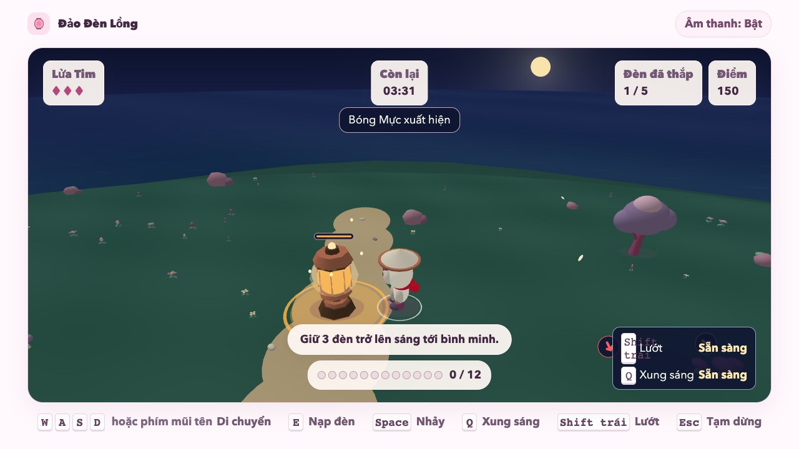

# Đảo Đèn Lồng

**[Video demo MP4](https://github.com/ThanhBinh101/K5-L3A-DAY12-NguyenThiThanhBinh-2A202603497-AI-SDLC-Dao-Den-Long/releases/download/v1.0.0/demo.mp4)** · [Báo cáo](docs/BAO-CAO.md) · [Hướng dẫn tự làm](docs/HUONG-DAN.md) · [Release v1.0.0](https://github.com/ThanhBinh101/K5-L3A-DAY12-NguyenThiThanhBinh-2A202603497-AI-SDLC-Dao-Den-Long/releases/tag/v1.0.0)

Trong game 3D góc nhìn thứ ba của Day 12 AI SDLC, Mây đi qua Đảo Bến, Đảo Cau và Đảo Chuông để giữ đèn sáng đến bình minh.



## Chạy game

Cần Node.js 20+ và trình duyệt hỗ trợ WebGL2 trên macOS hoặc Linux. Không cần cài package npm.

```bash
npm start
```

Mở [http://127.0.0.1:4173](http://127.0.0.1:4173) và chọn **Bắt đầu chơi**. Trong Release, có thể tải gói `dao-den-long-v1.0.0.tar.gz` và chạy `node tools/serve.mjs` tại thư mục đã giải nén.

| Mặc định | Hành động |
| --- | --- |
| WASD, phím mũi tên | Di chuyển |
| Space | Nhảy |
| Shift | Lướt |
| E | Nạp ánh sáng hoặc châm dầu |
| Q | Tỏa Sáng, tốn ba đom đóm |
| Esc hoặc P | Tạm dừng |
| Kéo chuột trên sân chơi | Xoay camera |

Mỗi đêm, giữ Mây còn lửa đến bình minh cùng ít nhất 3/5, 4/6 hoặc 5/7 đèn sáng. Nạp 10 đom đóm để thắp lần đầu, hoặc 5 để thắp lại. Châm dầu trước khi đèn tắt. Khi dầu dưới 30, Bóng Mực có thể vào vùng đèn và hút dầu. Bảng xếp hạng cộng điểm các đêm đã thắng. Xem [cách tính điểm](docs/phase-3.md) và [cách chơi từng bước](docs/HUONG-DAN.md).

## Kiểm chứng

```bash
npm run verify
node tools/headless.mjs --seed 42 --night 1 --ticks 300 --out run.jsonl
node tools/bench.mjs --seed 42 --duration 30 --out bench.json
npm run soak -- --seed 7 --nights 10 --out soak.json
node tools/serve.mjs --export-leaderboard leaderboard.json
```

Bench cần Chrome hoặc Chromium và desktop đồ họa. Nếu cần, đặt `DAY12_BROWSER` tới tệp thực thi của trình duyệt. Lệnh mở cửa sổ Chrome riêng, dùng cờ tắt VSync và đo sau 3 giây khởi động. WebGL trong trình duyệt không cung cấp RSS tiến trình nên `peak_mem_mb` là `null`. Soak đo RSS một tiến trình headless, chạy Node với `--jitless --max-semi-space-size=1` để giới hạn bộ nhớ của runtime và giữ cách đo tái lập. Lưu bảng xếp hạng ở `.data/leaderboard.json`; có thể dùng `DAY12_LEADERBOARD_FILE` để chọn đường dẫn khác. Gói phát hành được tạo bằng `npm run package`.

[Contract v1.3](game.contract.json) · [Bằng chứng Phase 1](docs/proof/phase-1/) · [Phase 2](docs/proof/phase-2/) · [Phase 3](docs/proof/phase-3/) · [Phase 4](docs/proof/phase-4/) · [Changelog](CHANGELOG.md)

## Sáng tạo của tôi

Mây có nón lá treo đèn nhỏ. Hoa, nơ, nấm và giấy của giao diện dùng hồng pastel, đi cùng màu tín hiệu theo đề. Đèn hết dầu xẹp xuống và có vết rách, nên có thể phân biệt bằng hình dạng. Các chi tiết trang trí nằm ở bộ hiển thị 3D và không thay đổi mô phỏng headless. Video và bộ kiểm chứng cho phép đối chiếu hai phần.

[Nguồn và công cụ](CREDITS.md) · [Giấy phép mã](LICENSE) · [Đề chung](docs/LAB-README.md)
